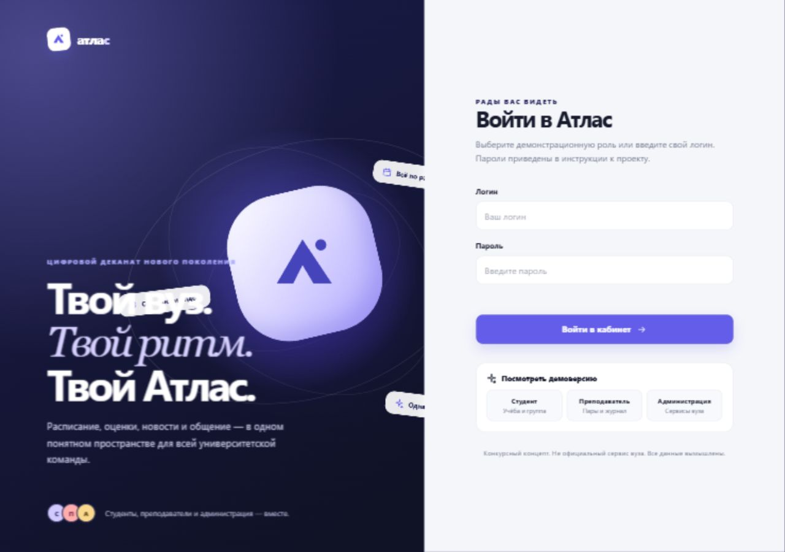
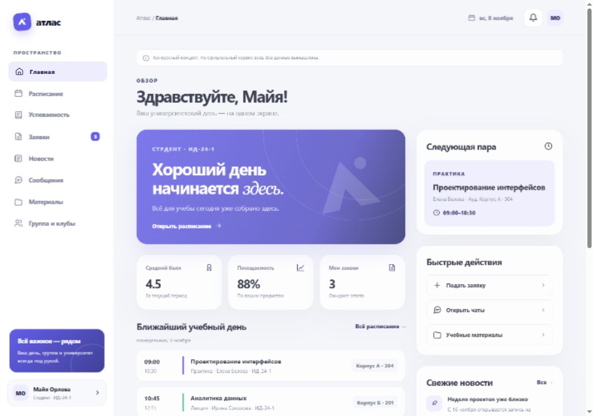
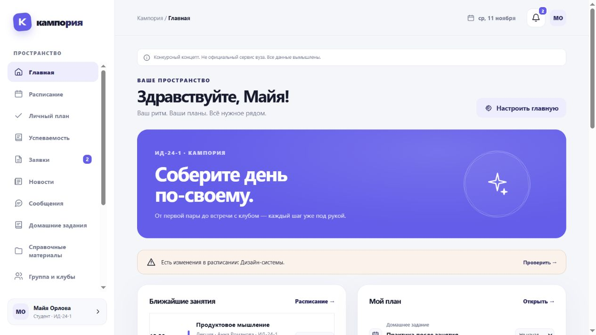
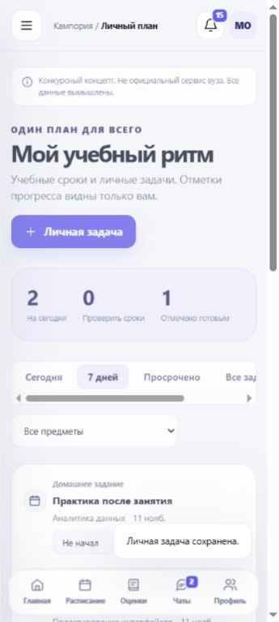
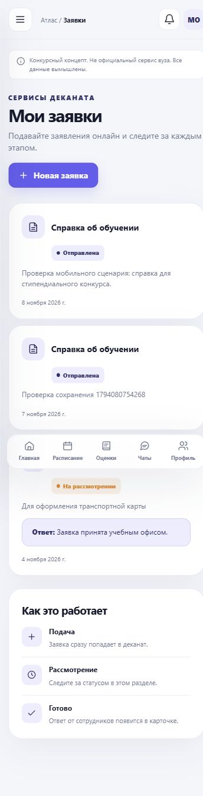
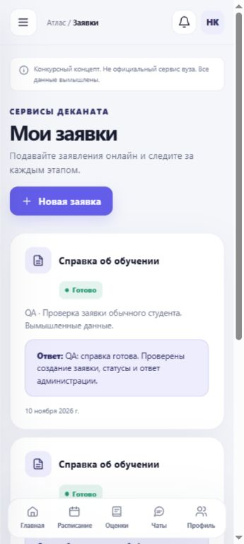
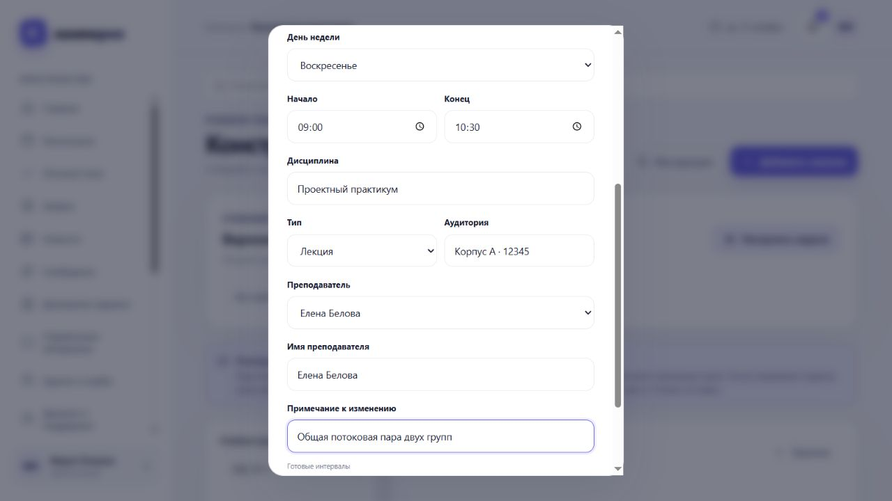
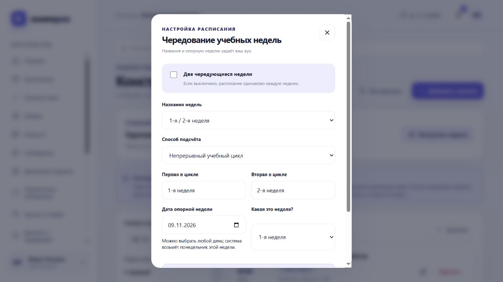
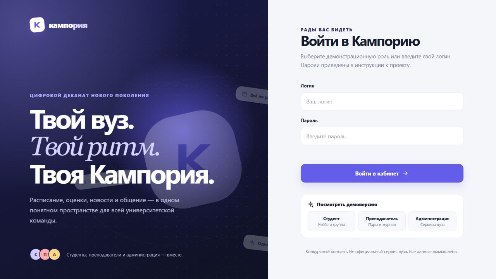

# Кампория: процесс создания конкурсного прототипа

Версия приложения v14, 11 ноября 2026.

## Кампория

Учебный день без поискапо разным системам.

Как из конкурсного задания и последовательных диалогов с ИИ получился работающий кабинет студента, преподавателя и администрации.

Публикация v14Четыре демо-аккаунта. Две разные студенческие группы. Мобильный интерфейс от 360 px. Настраиваемое чередование недель и общие занятия для нескольких групп.

Рабочий прототип: https://kamporia.ru

Исходники и документы: https://github.com/unfrizer/kamporia

Проект раньше назывался «Атлас». Это самостоятельный конкурсный концепт, не официальный сервис университета. Реальные системы вуза не подключены. Опросы студентов не проводились: продуктовые решения основаны на ТЗ и уточнениях участника.

## Один кабинет вместо разрозненных задач

Студенту приходится искать расписание, оценки, объявления и порядок получения справки в разных местах. С телефона особенно легко пропустить перенос пары или потерять статус обращения.

Поэтому главная показывает следующий шаг дня, а каждый раздел доводит действие до сохранённого результата. Кабинеты сотрудников завершают ту же цепочку: преподаватель публикует задание, администрация отвечает на заявку.

| Задача студента | Раздел и причина выбора |
| --- | --- |
| Куда идти и что изменилось? | Расписание на день и неделю: время, аудитория, преподаватель, переносы и отмены. |
| Как идут дела с учёбой? | Успеваемость: оценки, посещаемость и сессия в одном обзоре. |
| Как получить документ? | Заявки: форма, история, статус и ответ сотрудника. |
| Что важно не пропустить? | Новости, уведомления и личный план связывают объявления, ДЗ и сроки. |
| Где найти помощь и материалы? | Карточка дисциплины, общие и авторские пособия, деканат и поддержка. |
| Как общаться внутри вуза? | Личные сообщения, группа, клубные стены и события с проверкой членства. |

Обязательное ядро взято из конкурсного ТЗ. Дополнения предложены участником и согласованы в диалоге; их цель - связывать повседневные действия, сохраняя понятную навигацию.

## Начало: сценарии, архитектура и первый экран

Работа началась с чтения файла 2.txt и матрицы требований: обязательное ядро, мобильность, вымышленные данные, изоляция двух студентов и состав подачи. Рабочая папка была пустой.

Ранний реальный экран входа под рабочим названием «Атлас».

Ранняя главная: ближайшие занятия, новости и учебные показатели.

Неудачная попытка: шаблон Vinext не удалось установить: npm отсутствовал, pnpm получал EACCES при обращении к реестру. После этого выбран Worker ESM на HTML, CSS и JavaScript без внешних npm-зависимостей. Первые макеты до реализации не сохранялись; эти кадры показывают уже работающую раннюю версию.

## Оформление под пользователя, навигация под устройство

Светлая и тёмная темы, собственный акцент, спокойные поверхности и единые кнопки связывают разделы. Контрастный цвет текста подбирается к акценту. Настройки сохраняются в браузере.

Главная v12 после смены названия и добавления виджетов.

Личный план, 360 px.

Доработки по обратной связи: убраны дубли нижней навигации в мобильном меню; краткая карточка профиля отделена от редактирования; материалы сгруппированы по предмету и автору; изображения и документы получили разные карточки. Длинные номера аудиторий переносятся внутри рамки.

Motion design: появления экранов, переходы и уведомления дают обратную связь. Настройка prefers-reduced-motion сокращает декоративное движение. Для загрузки, ошибок и пустых данных предусмотрены текстовые состояния.

Скриншоты - реальные этапы разработки, а не отдельные кликабельные макеты. Изменения v13-v14 продолжили ту же визуальную систему.

## От запроса справки до ответа деканата

После входа сервер определяет пользователя. Студент видит свою группу, занятия и результаты. Он создаёт заявку, возвращается к истории и получает ответ сотрудника в том же кабинете.

Ранний мобильный список заявок.

Реальная проверка обращения в браузере.

Связанные действия: из занятия открываются ДЗ и карточка дисциплины; там собраны материалы, преподаватели, ближайшие занятия и собственные результаты. В личном плане видны сроки и приватные задачи. В клубе доступны описание, стена и события; чат - по членству.

Второй студент имеет другую группу, оценки и заявки. Уведомления о своей группе доступны ему, а частные записи первого студента сервер не возвращает даже при подстановке чужого идентификатора.

## Одна пара - несколько групп. У каждого свои полномочия

Администрация составляет повторяющийся шаблон. В форме занятия выбираются предмет, преподаватель, день, время, аудитория и любое число существующих групп. Одна запись отображается во всех выбранных группах; перенос и отмена общие.

v14, отдельная тестовая копия: в форме выбраны две группы и нижняя неделя.

Преподаватель: ведёт журнал по доступным дисциплинам и группам, публикует ДЗ и материалы, создаёт свои разовые пары. Может менять дату, время и аудиторию, отменять и восстанавливать собственные занятия. Назначение другого преподавателя и изменение недельного шаблона доступны администрации.

Общение: преподаватель и администратор не прикрепляются к студенческой группе и не получают её чат. Для работы есть личные сообщения студенту или старосте и клубные чаты при наличии членства. Ограничения проверяются на сервере.

## Чередование недель по правилам конкретного вуза

Реальный экран kamporia.ru после публикации v14. Администратор выбирает правило; прежнее расписание сохранено как занятия каждой недели.

Названия: 1/2, верхняя/нижняя, нечётная/чётная либо свои подписи. Непрерывный цикл: чередование от опорной даты без сброса на Новый год. Календарный способ: ежегодная нумерация недель ISO; после 53-й и 1-й недели тип может повториться. Занятие повторяется каждую неделю или только в один тип.

Общие пары: проверен пример для 122 групп. При сохранении проверяется каждая группа, преподаватель и аудитория; учитываются датированные переносы и подтверждённые консультации. Одновременные конфликтующие изменения защищены проверкой ревизии.

История изменений: создание, правка, перенос, отмена и восстановление сохраняют отдельные уведомления. Студент видит их и после отсутствия на сайте. Встроенная инструкция администрации расширена до 17 глав.

## Где использовался ИИ, а где обычные средства разработки

| Инструмент или сервис | Реальное применение |
| --- | --- |
| Codex Desktop: основной ИИ-ассистент и субагенты | Разбор ТЗ, проектирование, генерация и интеграция кода, независимый обзор, исправления, тексты и сценарии проверки. |
| Sites | Первый проект и публикация Worker/D1/R2, история версий и закрытая резервная публикация. |
| Browser / Computer Use, веб-поиск | Работа с интерфейсом, реальные скриншоты, поиск официальных источников, проверка имени, панели провайдера и DNS. |
| Node.js, HTML, CSS, JavaScript, SQLite | Код приложения, сборка, сервер, миграции, сохранение данных и HTTP-проверки. |
| PowerShell, rg, Git, GitHub | Файлы и поиск, запуск команд, история исходников и публичный комплект для жюри. |
| pnpm, шаблон Vinext | Начальная неудачная попытка установки; зависимости шаблона в готовое приложение не вошли. |
| Python, Pillow, ReportLab, pypdf, Poppler | Кодовая афиша для примера вложения, подготовка PDF, извлечение текста, рендер страниц и визуальная проверка. |
| Selectel, DNS, Caddy, OpenSSH, systemd | Российский сервер и домен, HTTPS, защищённая установка, перезапуск приложения и резервная копия. |

ИИ использовался для постановки и решения задач разработки. Node.js, SQLite, Git, Python и серверные службы - программные инструменты и инфраструктура, а не дополнительные ИИ-модели. Интерфейс использует системный шрифт, собственные SVG и кодовые декоративные элементы.

## Требования участника задавали направление разработки

Ниже - сокращённые выдержки из реальных запросов в этом чате; опечатки исправлены. Многоточия обозначают пропуски. Результаты пересказаны, а не выданы за дословные ответы ассистента.

Старт / качество и интерфейс

«нужен индивидуальный современный приятный глазу интерфейс с элементами motion-design ... светлая или темная тема»

Результат: единая визуальная система, адаптация от 360 px, темы, акцентный цвет и уменьшение движения.

Роли / связанные сценарии

«можно сделать разные аккаунты для студентов, учителей, администрации с различными функциями»

Результат: два студента разных групп, преподаватель и администрация; роли связаны через задания, журнал, новости и заявки.

Проверка / действия каждого участника

«проверь все ли кнопки кликабельные ... попробуй внести изменения от каждого участника(поменять расписание, написать дз, запросить справку и тд)»

Результат: проверки создания и сохранения записей, ролевых ограничений, чужих идентификаторов и проходов интерфейса.

Навигация / избавление от повторов

«по факту просто убери повторяющиеся ссылки которые по факту кажутся лишними»

Результат: разделены краткая карточка и профиль; мобильное боковое меню дополняет нижнюю панель; оформление вынесено в свой раздел.

## Запрос → проверяемое изменение продукта

Задача ассистенту / аудит ТЗ

«Сделай точный список обязательных требований, ограничений, критериев оценки и возможных противоречий с пожеланиями пользователя. Ничего не редактируй.»

Результат: матрица обязательного ядра и ограничений. На раннем этапе отдельные субагенты проверяли сервер, UI, документацию и безопасность.

Доступность / пользователь

«доступ к сайту без впн через обычный браузер недоступен, надо сделать его полностью рабочим без использования впн»

Результат: перенос с исходного хостинга на Selectel, собственный домен и HTTPS; пользователь сообщил об успешном открытии и входе студента.

Недели и преподаватель / пользователь

«расписание с чередующимися неделями ... у каждого вуза они могут быть разными ... только в свое ... должны приходить уведомления»

Результат: настраиваемый цикл и названия; свои разовые пары преподавателя; сохранённая история уведомлений.

Несколько групп / пользователь

«на одной паре может быть сразу несколько групп без ограничений»

Результат: таблица связей занятия с группами, проверка пересечений по каждой группе; автоматический пример со 122 группами.

Реальная ошибка и исправление: ранний обработчик темы находил data-theme у корневого html при любом клике. Нажатие «Войти» перерисовывало форму и очищало поля. После браузерной проверки селектор ограничен кнопками; ресурсы получили версию в URL для обновления кэша.

## Личные данные определяет серверная сессия

1. Вход. Логин и пароль передаются по HTTPS. Сервер проверяет пароль через PBKDF2-SHA-256 с индивидуальной солью и 100 000 итераций. В таблице пользователей хранятся хэши, а не открытые пароли.

2. Сессия. После входа браузер получает случайный токен в cookie HttpOnly, Secure и SameSite=Lax. JavaScript страницы не читает эту cookie. В базе хранится хэш токена; выход завершает сессию.

3. Права. При каждом запросе сервер определяет пользователя и проверяет роль, владельца записи, дисциплину, группу или членство. Подстановка чужого адреса не заменяет эти проверки. Краткая карточка человека не выдаёт его оценки, заявки или личные контакты.

4. Сохранение. На основном сервере записи находятся в постоянной SQLite, вложения - в отдельном каталоге. Перезапуск не сбрасывает заявки. Настройки темы остаются в браузере; учебные записи сохраняет сервер.

5. Изменения и файлы. Изменяющие запросы проверяют Origin; SQL использует параметры. Загружаемые вложения ограничены типом и размером, их выдача следует правам записи. Ключи сервера и данные провайдера не включены в публичный комплект.

Демонстрационный режим. Пароли четырёх вымышленных аккаунтов передаются жюри открыто по условию конкурса. Люди, вошедшие под одним демо-логином, пользуются одной демонстрационной личностью. Для настоящего внедрения потребуются индивидуальные аккаунты, политика обработки данных и отдельный аудит.

## Проверки действий, сохранения и разграничения доступа

| Изолированный сценарий | Проверок |
| --- | --- |
| Четыре ролевых пути, сохранение, чужие записи | 201 |
| Сообщества, материалы и вложения | 142 |
| Календарь и разовые изменения | 80 |
| Управление и права | 113 |
| События и уведомления | 107 |
| План, консультации, клубные события, предметы | 174 |
| Доступ сотрудников и правки своего расписания | 96 |
| Недели, 122 группы, история и гонки записи | 141 |
| Итого на отдельной копии | 1054 |

Дополнительно пройдены 15 клиентских проверок кэша и навигации и 132 проверки четырёх ролей через публичный HTTPS. Изменяющие автоматические сценарии запускаются на отдельной копии данных. Через браузер проверены формы и мобильная ширина 360 px.

После установки: SQLite integrity_check вернул ok; 34 прикладные таблицы сверены с ожидаемым результатом миграции; все 9 вложений сохранены побайтово. Публичные HTML, JS, CSS и значок совпали с проверенной сборкой.

Это проверка функционального прототипа. Массовый нагрузочный тест, независимый аудит безопасности и проверка всех российских сетей не выполнялись.

## От закрытого резерва к собственному адресу

Исходная публикация оказалась недоступной пользователю без VPN. Ассистент подготовил переносимый сервер Node.js, а участник выбрал Selectel, бюджет и название «Кампория». После предварительной проверки имени зарегистрирован kamporia.ru.

Реальная открытая страница входа после снятия внешнего пароля владельца по решению участника.

Ассистент: подготовил приложение и миграции, HTTPS и DNS-настройку, сценарии установки с резервной копией, проверку целостности и опубликованных файлов. При разрыве SSH во время v14 установка продолжилась на сервере; отдельное чтение итогового отчёта подтвердило её завершение.

Участник вручную: сформулировал и уточнял функции, выбирал название и хостинг, создал аккаунт провайдера, пополнил баланс, заполнил данные владельца домена и подтвердил телефон. Проверял доступ из своей сети, сообщал ошибки и успешный вход студента, переключал VPN для установки. Платёжные данные не передавались в чат.

Ручное программирование участником не заявляется: код и документы создавались с помощью ассистента. Эмуляцию 360 px выполнял ассистент; отдельная проверка участником на физическом телефоне не фиксировалась.

## Комплект для знакомства с прототипом

Прототип: https://kamporia.ru

Исходный код: https://github.com/unfrizer/kamporia

Описание в браузере: https://github.com/unfrizer/kamporia/blob/main/docs/process.md

| Аккаунт | Логин | Демо-пароль |
| --- | --- | --- |
| Студент, ИД-24-1, староста | student.1 | DemoStudent1!2026 |
| Студент, ПИ-23-2 | student.2 | DemoStudent2!2026 |
| Преподаватель | teacher | DemoTeacher!2026 |
| Администрация | admin | DemoAdmin!2026 |

Что считаю главным. Важна законченная цепочка действия: изменение расписания доходит до студента, обращение получает статус и ответ, а личные данные остаются в пределах полномочий. Дизайн и дополнительные функции поддерживают этот путь.

Границы прототипа: данные и схема кампуса вымышлены; нет интеграции с настоящим вузом, импорта Excel или автоматического составления расписания. Чередование включает администрация под правило своего учреждения. Новая пара преподавателя относится к конкретной дате.

Перед конкурсной отправкой: повторить проход с физического телефона и другого устройства без VPN, проверить доступ к ссылкам и баланс хостинга до 28 ноября. Работа в кабинет организатора в этой сессии не отправлялась.

Версия кода приложения: v14, коммит84b1355f764d0d951f5ad127f597b4f033d42939.В публичном репозитории размещён снимок этой версии с итоговой документацией. Ранние имена «Атлас» и скриншоты в отчёте обозначают этапы одного проекта.
